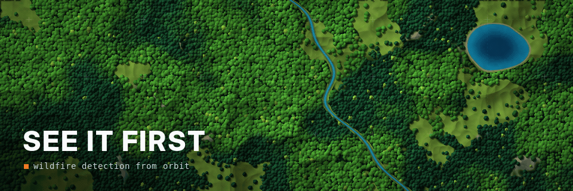

<!-- STATS -->


<h1 align="center">Hi 👋, I'm Fares</h1>

<!-- ======================= -->
<!-- HERO / TOP BANNER AREA -->
<!-- ======================= -->
<p align="center">

</p>


<h2 align="center"> AI Researcher @ Ericsson | Master's of Data Science @ McGill | Applied ML & AI</h2>


<h3 align="left">Languages and Tools:</h3>
<p align="left"> <a href="https://aws.amazon.com" target="_blank" rel="noreferrer">  </a> <a href="https://azure.microsoft.com/en-in/" target="_blank" rel="noreferrer">  </a> <a href="https://cassandra.apache.org/" target="_blank" rel="noreferrer">  </a> <a href="https://www.docker.com/" target="_blank" rel="noreferrer">  </a> <a href="https://www.figma.com/" target="_blank" rel="noreferrer">  </a> <a href="https://cloud.google.com" target="_blank" rel="noreferrer">  </a> <a href="https://kafka.apache.org/" target="_blank" rel="noreferrer">  </a> <a href="https://kubernetes.io" target="_blank" rel="noreferrer">  </a> <a href="https://www.mysql.com/" target="_blank" rel="noreferrer">  </a> <a href="https://pandas.pydata.org/" target="_blank" rel="noreferrer">  </a> <a href="https://www.python.org" target="_blank" rel="noreferrer">  </a> <a href="https://pytorch.org/" target="_blank" rel="noreferrer">  </a> <a href="https://scikit-learn.org/" target="_blank" rel="noreferrer">  </a> <a href="https://seaborn.pydata.org/" target="_blank" rel="noreferrer">  </a> <a href="https://www.tensorflow.org" target="_blank" rel="noreferrer">  </a> <a href="https://unity.com/" target="_blank" rel="noreferrer">  </a> <a href="https://unrealengine.com/" target="_blank" rel="noreferrer">  </a> </p>


<p align="center">
  <a href="https://github.com/KnightBytePy?tab=repositories">
    
  </a>
  <a href="mailto:knightpy6@gmail.com">
    
  </a>
</p>

<p align="center">
</p>

---

## 🛰️ Featured Project

### See It First: Satellites vs Humans — Wildfire Detection from Satellite Imagery
<p align="center">
  
</p>

**What it is**
- Computer vision on 6 years of daily NASA satellite imagery (VIIRS) of Alberta, trained to spot wildfires using NASA's own heat detections as labels
- Benchmarked 5 models (U-Net, DeepLabV3+, SegFormer, 2 baselines) with a leakage-safe time split and a one-time frozen test on years no model had seen
- Tested once on 2,230 wildfires Alberta recorded in 2023–2024: found 85–88% of large (100+ ha) fires, PR-AUC 4–11× a colour-threshold baseline
- Over all 6 years (6,474 recorded fires), a satellite spotted only 15 before people reported them — mostly remote lightning fires

<p align="center">
  
  <br><sub>NASA's heat detections (red) vs my U-Net (yellow) vs reported fires (cyan ring) — here people were first, by 2–3 days.</sub>
</p>

**Why it matters**
- Full ML lifecycle on real geospatial data: Airflow/Docker ingestion → PyTorch training → statistically rigorous evaluation (bootstrap CIs, McNemar tests) → a FastAPI/MapLibre dashboard to explore every result

**Status:** Private / request access

---

## 🔥 Old Projects

### 1. Customer Churn Intelligence Dashboard <a href="https://fares-shawrma-churn-shop.streamlit.app/" target="_blank"></a>
<p align="left">
  <!-- dashboard / analytics-style animated charts -->
  
</p>


**What it is**  
- Churn model using SMOTE + XGBoost (F1 on churners = 0.88)  
- Flags high-risk customers and simulates “what if we give this segment a 10% discount?”  
- Delivered in Streamlit so non-technical teams can use it

**Why it matters**  
- It's not “here’s a model,” it’s “here’s who to save today and how.”

**Repo:** [`customer-churn-streamlit`](https://github.com/KnightBytePy/customer-churn-streamlit-xgboost)
---

### 2. Hybrid Time Series Sales Forcasting - Tensorflow/Keras (LSTM) | Prophet | XGBoost | Hybrid Ensemble
<p align="left">
  <!-- animated stock/time-series style line trend -->
  
</p>

**What it is**  
- Hybrid LSTM + Prophet + XGBoost forecaster on ~421k rows of Walmart-style weekly sales  
- Handles promo spikes, seasonal effects, macro signals

**How it's built**  
- Leakage-safe time-aware CV  
- Rolling / lag features  
- Holiday & promo awareness

**Why it matters**  
- Helps planners avoid stockouts during high-demand weeks

**Repo:** [`chronosblend-forecasting`](https://github.com/KnightBytePy/hybrid-timeseries-forecasting)

---

### 3. Credit Risk Default Pipeline 
<p align="left">
  <!-- neural-net / AI brain vibe -->
  
</p>

**What it is**  
- Default probability model with gradient boosting  
- SHAP explanations: “here’s exactly why this borrower is high risk”  
- Outputs risk tiers underwriter teams can defend to compliance

**Why it matters**  
- Turns “black box says no” into transparent, auditable reasoning

**Repo:** [`credit-risk-scoring`](https://github.com/KnightBytePy/credit-risk-default-prediction)

---

### 4. Steam Reviews Segmentation & Topic Mining
<p align="left">
  <!-- data scan / NLP at scale vibe -->
  
</p>

**What it is**  
- Analyzed ~6,000,000 Steam game reviews to understand player sentiment, pain points, and engagement drivers  
- NLP pipeline: text cleaning → TF-IDF → NMF topic modeling → SentenceTransformer embeddings → clustering  
- Generated player segments (“performance complainers”, “balance grinders”, “content hunters”) a studio could target

**Why it matters**  
- It's automated voice-of-customer analytics: you can point this at any product with reviews and instantly know what to fix first

**Repo:** [`steam-reviews-segmentation`](https://github.com/KnightBytePy/7Msteam-reviews-unsupervised-nlp)

---

### 5. State of the Art - Streaming Multi-Lingual Sentiment & Topic Intelligence for Social Media | PyTorch | Transformers | MCP | RAG (Discontinued) 
<p align="left">
  <!-- scrolling code / data stream vibe -->
  
</p>

**What it is**  
- Streaming pipeline that ingests multilingual social media posts via Kafka and enriches them with language detection, sentiment, and topic labels in near real time
- NLP stack: Hugging Face transformers (XLM-R) in PyTorch for sentiment → multilingual sentence embeddings → BERTopic-style clustering for human-readable topics
- Analytics layer: PySpark Structured Streaming + Postgres/ClickHouse + FastAPI/dashboard to explore sentiment trends, top topics, and language breakdowns by brand and time window

**Why it matters**  
- Acts as a real-time, multilingual “voice of customer” engine: brands can see what people are saying, in which language, and how sentiment shifts after a campaign or incident
- Shows I can ship production style NLP systems end-to-end: streaming data engineering, deep learning, topic modeling, APIs, and dashboards not just offline notebooks
  
**Status:** Private / request access
--- 

## 🛠 Tech Stack
```text
Core : Python, SQL, Pandas, NumPy
Modeling : Scikit-learn, XGBoost, LightGBM, CatBoost
Deep / Time Series : PyTorch, Keras (LSTM), Prophet, time-aware cross-validation
NLP & GenAI : Hugging Face Transformers, SentenceTransformers, TF-IDF, NMF topic modeling, BERTopic-style clustering, RAG patterns
Streaming / Big Data : Apache Kafka, PySpark (Structured Streaming)
Apps & APIs : Streamlit dashboards, FastAPI services
Infra & MLOps : Docker, VS Code Dev Containers, MLflow
Explainability : SHAP, model interpretability (global & local)


